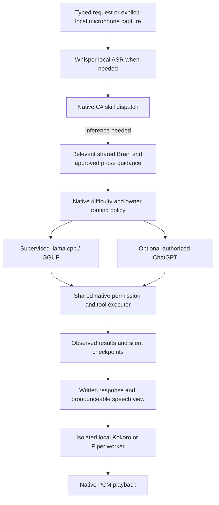

# Laura 2.2: local-first operation and recovery

## Runtime

Core owns protocol-independent text messages, the orchestration loop, persona, Brain and task records. Windows owns the supervised local server, private voice worker pipes, microphone and playback. Composition connects adapters in ServiceConfiguration. The provider router selects local llama.cpp or account-authorized ChatGPT. The previous Google client, protocol and diagnostics were removed from the compiled source; older architecture notes remain as historical records.

Native deterministic skills precede inference. Automatic routing uses `Light` local capability by default, optionally `Standard`; larger demands choose only configured authorized cloud. Manual selection remains fixed, including complex requests. `Native`, `Light`, `Standard`, `Advanced`, `Max` are exact technical tags. Max requires explicit owner consent, an included-plan setting and a separately selected model that passed a synthetic account probe. An unavailable Max model fails closed. Provider-discovered cloud models remain separate from a configurable local GGUF filename.

Automatic fallback is bounded to each authorized provider once, only on an initial text request with no provisional output or possible native effects. Failed adapters receive bounded cooldowns. Image, manual and continuation requests do not silently reroute. Task receipts and source hashes survive bounded silent cycles. HUD/task details display observed step/tool counts and difficulty, without a fabricated percentage, completion or estimate.

## Installation and defaults

Settings has a vertical navigation rail: Connections, Models, Voice, Preferences,
Applications, Permissions, MCP. GPT is in Connections. Models contains
Qwen, llama.cpp, Whisper, Kokoro, Piper and voice identity. Advanced paths and budgets are
collapsed by default. A single explicit Install models and voice action downloads
the displayed size/licenses, verifies the pinned pack, configures every path and
saves it immediately; no separate daemon, runtime installation or manual enablement
is needed. No model is downloaded during restore, build or unrequested startup.

The default model store is the existing Documents/Laura Virtual Assistant/Models,
beside Brain, resolved through the Documents known folder. Model files are placed
directly in Models without creating subdirectories. Existing unrelated files and
directories remain untouched. The pinned Qwen filename includes its source revision
to avoid overwriting an existing differently converted quantization. Downloads,
executables, extraction staging and phonemizer data live separately under Runtime.
Kokoro model, voices and vocabulary use a kokoro- filename prefix; Whisper keeps
base-encoder.int8.onnx, base-decoder.int8.onnx, small-encoder.int8.onnx,
small-decoder.int8.onnx and base-tokens.txt. Piper Dii and Cori use piper- prefixes.
The worker also
reads legacy layouts for existing profiles.

The pinned runtime is llama.cpp b11669 Vulkan, including CPU backends. Automatic
mode enumerates the verified runtime's real hardware devices and offloads model
layers to Vulkan when compatible hardware exists. Software Vulkan adapters do not
qualify. CPU is selected when no compatible GPU is enumerated. A GPU startup failure
is reported rather than silently rerunning a GPU request on CPU. Qwen3.5-4B Q4_K_M
is the starter model; local voice uses multilingual Kokoro/Piper and Whisper Small ONNX, with Whisper Base as fallback.
Whisper and Kokoro use the isolated CPU ONNX worker; Qwen GPU offload and Vulkan HUD
rendering are independent. No Ollama, Python, Node or global model daemon is needed.

Downloads resume into .partial and verify exact size/SHA-256 before rename. Extraction
rejects links/traversal and checks its inventory on reuse. Differing existing files
are preserved for inspection. The published application's pinned Microsoft C++
redistributables are copied beside llama-server.exe with RuntimeLicenses and included
in its integrity manifest. Imported runtimes still require native trust/hash review.

Preferences offers optional Vulkan reactor acceleration. A bundled native renderer
owns a Win32 child surface, hardware Vulkan device and swapchain. Presentation and
resize waits stay on its dedicated thread; no CPU image rasterization/readback is used
for presentation. Native MAUI/WinUI controls retain the Windows compositor, not a
claimed Vulkan backend. Hiding/navigating away suspends presentation. Missing Vulkan
or initialization failure retains the standard vector renderer; disabling Windows
animations uses the static accessible renderer. The idle UI timer is 10 Hz, active
feedback at most 30 Hz, with fewer glow passes. Monitor sampling skips hidden panels,
settings panels load on demand, and streamed bubbles update native text in place at
most roughly 12 times per second instead of recreating their control trees per token.

Cloud opt-ins and manual provider selection remain independent. Existing editable
persona text is preserved. The old INI LiveVoice field is inert rollback data.

## Voice and privacy

Microphone capture requires an explicit button, held Ctrl+Space or opted-in local double-clap detection, with an unmuted setting. A local RMS endpoint detector rejects silence/short impulses and ends voiced turns on silence, bounded to 30 seconds. The device closes before ASR/inference/playback, reducing speaker echo. This is half duplex, not acoustic echo cancellation. Mute/stop/cancel/shutdown cancel capture and owned inference; releasing push-to-talk may submit the captured valid utterance. Early release during startup prevents a later microphone start.

Whisper performs local language recognition by default or manual pt/en selection. Conversation language still controls model response and speech language. Portuguese defaults to the female Brazilian Piper Dii voice; English offers female American Kokoro voices and the female British Piper Cori voice. Dii is licensed CC BY-NC-ND 4.0 for noncommercial use. The British option is documented as UK English; a specific Modern RP accent has not been independently established. Provider switching never changes the selected voice within a language. Speech removes Markdown/code fences/URLs and bounds synthesis into prose segments without editing the written artifact. Missing or failed voice assets leave written chat available; there is no cloud voice fallback. The native worker has no microphone, HTTP client or tool executor and is canceled by terminating only its owned process.

Local manual inference transmits neither prompts nor audio to cloud providers. Enabled cloud text providers receive recognized text and approved bounded context under their policies. Explicit weather/news/currency/browser/GitHub tools can require Internet; offline inference does not fabricate fresh facts or disable Windows networking system-wide. Image sends use a separate exact bytes/model/recipient approval and the originating editor lifetime at each network round. Speech/diagnostic logs contain no PCM, transcript, note bodies, private paths or credentials.

## Recovery and rollback

Stop Laura before replacing application binaries. Keep the complete previous application folder and the owner's settings backup outside the package. Updating binaries never requires deleting Documents/Laura Virtual Assistant or the shared Brain. To disable local inference, turn it off and choose another already authorized text provider. Remove local voice paths to use text only. Installed models are separate from the app and are not removed during an update. Imported/shared artifacts are never cleanup candidates. To remove an optional pack, stop Laura, clear saved paths, verify the chosen installation directory and use Windows to remove only that explicitly selected pack. Do not delete a shared parent folder or an independently authored Brain.

Failed downloads keep bounded partial files. A changed verified artifact stops reuse; inspect it and restore only from the pinned original download. Extraction stages belong to one installer invocation and are cleaned after failure/cancellation. Installing a new pack in a separate destination preserves the previous pack for rollback. Local settings store only paths/hashes/resource options in BOM UTF-8 INI; credentials remain separate.

Release distributions include the isolated native worker, full license notices, native hashes and verified corresponding sources. See [source provenance and rebuild instructions](local-voice-sources.md). Model weights are separate opt-in downloads. The [implementation report](../../LAURA-2.2-MIGRATION.md) distinguishes automated acceptance from physical microphone, accent and listening evaluation.
